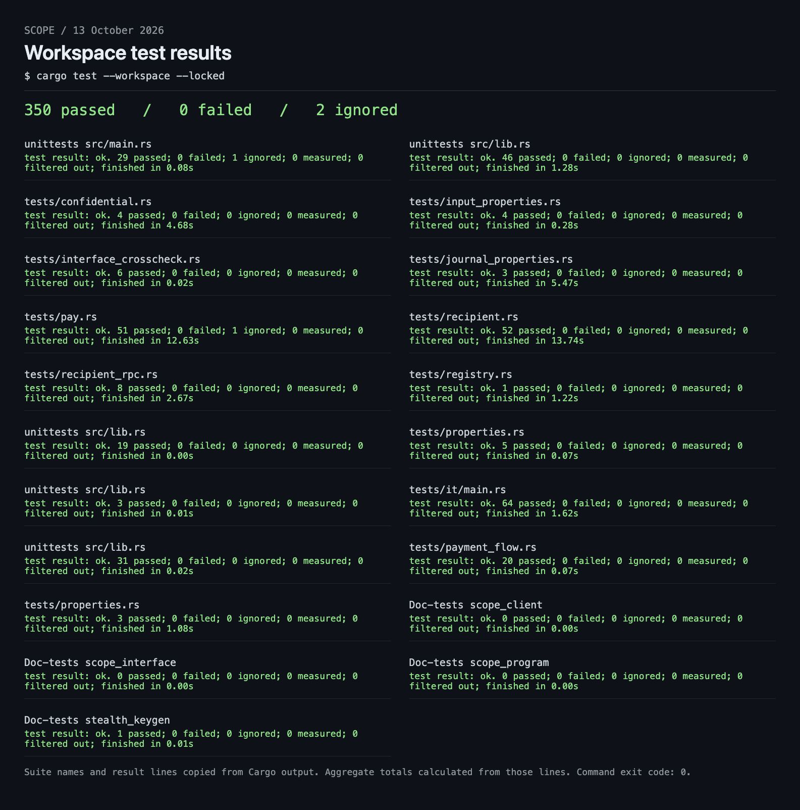
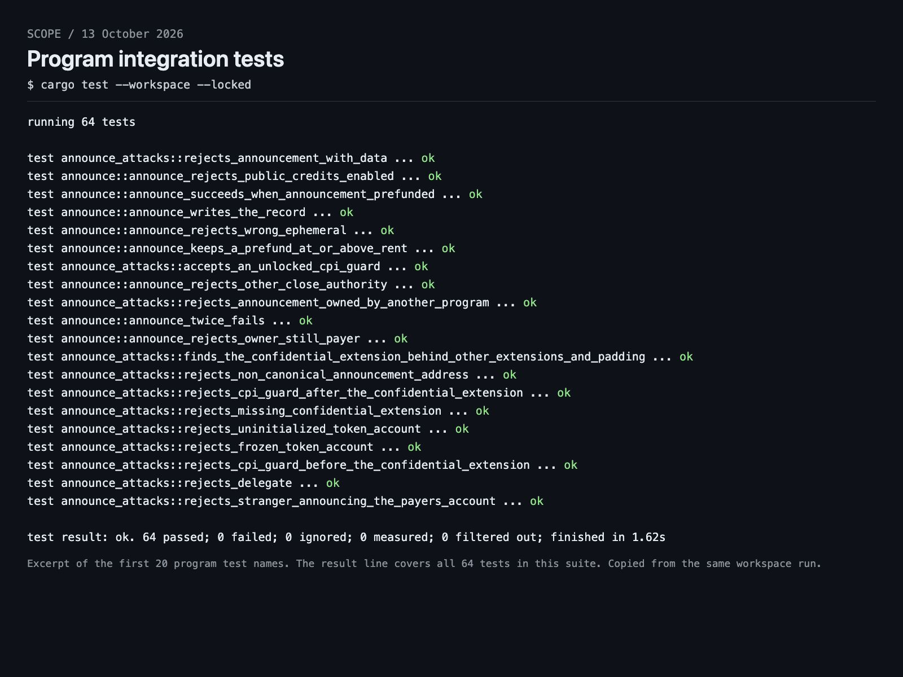

```text
  ____   ____ ___  ____  _____
 / ___| / ___/ _ \|  _ \| ____|
 \___ \| |  | | | | |_) |  _|
  ___) | |__| |_| |  __/| |___
 |____/ \____\___/|_|   |_____|
```

SCOPE lets you pay people on Solana while keeping payment amounts private. Each recipient can receive payments in fresh accounts that hide their identity from the public. The payer sets up those accounts and funds collection, so recipients can collect payments without holding SOL. Tokens stay in ordinary Token-2022 accounts, with no shared pool or wrapped asset. The payer remains visible, and either side can prove a payment's amount with a receipt.

Devnet program: [`SCoPEvf7cwXjgzEQqqrJXN4gwU6TT81v1LC8vCZE5hT`](https://explorer.solana.com/address/SCoPEvf7cwXjgzEQqqrJXN4gwU6TT81v1LC8vCZE5hT?cluster=devnet)

## Get started

Install [Rust](https://rustup.rs/) and the [Solana CLI](https://solana.com/docs/intro/installation), then run from the repo root:

```sh
cargo install --path cli --locked
export SCOPE_URL="https://api.devnet.solana.com"
```

The payer needs SOL and a funded confidential Token-2022 account. Stealth payments need a mint that automatically approves new confidential accounts, without transfer fees or hooks. See [payer setup](docs/payer.md#before-you-start).

The default wallet is `~/.config/solana/id.json`; override it with `--keypair <FILE>`. Replace `<MINT>`, `<SOURCE>` and other placeholders with your values. `--url <RPC>` overrides `SCOPE_URL`.

## Pay

Create `payroll.csv` with amounts in token units. Recipients can be full `scope:` addresses or existing confidential token accounts:

```csv
recipient,amount
scope:<recipient-meta-address>,800
<recipient-confidential-token-account>,1250.50
```

| What you want to do | Command |
|---|---|
| Preview the batch without sending | `scope pay --dry-run --input payroll.csv --mint <MINT> --source <SOURCE>` |
| Send the batch | `scope pay --input payroll.csv --mint <MINT> --source <SOURCE>` |
| Resume an interrupted run | `scope pay --resume <RUN_ID>` |
| Check payment status | `scope pay --status <RUN_ID>` |
| Reclaim rent after recipients sweep | `scope pay --status <RUN_ID> --reclaim` |
| Look up a published recipient address | `scope lookup <RECIPIENT_WALLET>` |

Keep the run ID printed by `scope pay`. More options: [payer guide](docs/payer.md).

## Receive

Run `scope register` and share the printed address with your payer. Back up `~/.config/scope/recipient.key`; you need it to collect payments. Publishing is optional and publicly associates your address with your wallet.

| What you want to do | Command |
|---|---|
| Create your recipient keys and address | `scope register` |
| Print your address again | `scope meta-address` |
| Publish your address under a wallet | `scope publish` |
| Find incoming payments | `scope scan` |
| Collect a payment into a fresh account | `scope sweep --announcement <ANNOUNCEMENT>` |
| Collect all available payments | `scope sweep --all --jitter-secs 120` |
| Find past payments, including collected ones | `scope recover` |

Use the announcement address from `scope scan`. Add `--dry-run` to simulate a sweep. Publishing needs SOL; collecting payments uses the payer's funding. More options: [recipient guide](docs/recipient.md).

## Prove a payment

| Who | Command |
|---|---|
| Payer | `scope disclose --run <RUN_ID> --row <ROW> --out receipt.json` |
| Stealth recipient | `scope disclose --token-account <TOKEN_ACCOUNT> --out receipt.json` |
| Anyone checking a receipt | `scope verify receipt.json` |

Rows count from zero. Verification needs an RPC node with transaction history. Receipt details: [audit guide](docs/audit.md).

## Tests

Build the program before running tests; the integration tests load the compiled `.so` into LiteSVM.

```sh
cargo build-sbf --manifest-path programs/scope/Cargo.toml --tools-version v1.52 -- --locked
cargo test --workspace --locked
```

Local run on 13 October 2026: 350 passed, 0 failed, 2 ignored. CI also checks formatting, Clippy and dependencies. [Test coverage](docs/verification.md).

<details>
<summary>Test output screenshot</summary>

Screenshots of the saved Cargo output from the workspace run. The program view shows 20 test cases from the suite of 64. Click an image to open it at full resolution. [Full test output](docs/assets/tests/workspace-output.txt).

[](docs/assets/tests/workspace-results.jpg)

[](docs/assets/tests/program-tests.jpg)

</details>

## Further reading

The Pinocchio program lives in `programs/scope`, the CLI in `cli`, and shared libraries in `crates`. The full payment flow still needs Devnet validation. Spending to a known counterparty can reveal a recipient's identity. The cryptography has not had an external review.

[Protocol](docs/protocol.md) · [Cryptography](docs/crypto.md) · [Privacy](docs/privacy.md) · [Project status](docs/plan.md) · [All docs](docs/README.md)

## License

[MIT](LICENSE-MIT) or [Apache-2.0](LICENSE-APACHE), at your option. Contributions use the same dual license unless you explicitly state otherwise.
