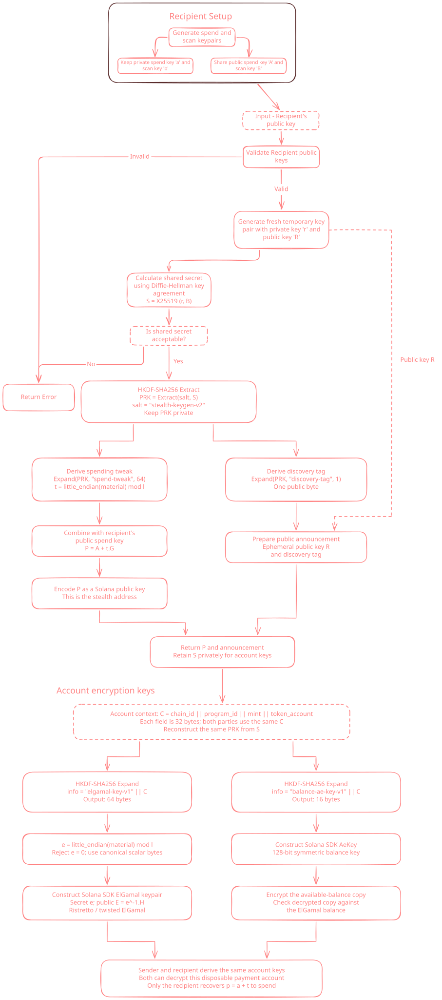

<h1 align="center">stealth-keygen</h1>

Stealth-address keys for SCOPE: recipient key generation, the `scope:` meta-address, one-time payment keys P, recovery of their signing scalars, and the per-account input for Token-2022 confidential keys.
Pure Rust with no Solana SDK dependency; the derivation rationale lives in [docs/crypto.md](../../docs/crypto.md).

<p align="center">
  
</p>

In the diagram, `(a, A)` is the spend key and `(b, B)` the scan key, written `(b_spend, B_spend)` and `(b_scan, B_scan)` in the docs. Type names use "sender" for the payer side (`SenderPayment`, `SenderError`).

## What it does

A payer takes the recipient's public keys and an ephemeral X25519 secret r and gets a one-time Ed25519 public key P plus an announcement (R and a one-byte discovery tag). The recipient uses its secret keys and the announcement to recover the scalar p for P and sign as P. Both sides can derive the same `ct_ikm` for one token account, which `scope-client` turns into the account's ElGamal and AE keys. The recipient alone can derive a seed for its sweep destination owner. All of it runs off-chain; account creation, proofs and receipts belong to `scope-client`.

A matching discovery tag only marks a candidate. Check that the token account's owner is P (and, in SCOPE, that its ElGamal key matches) before accepting a payment.

## API

| Item | Purpose |
|---|---|
| `RecipientSecretKeys::generate(&mut rng)` | New spend and scan secrets. |
| `RecipientSecretKeys::from_bytes([u8; 64])` | Restore from backup: canonical little-endian spend scalar, then the raw X25519 scan secret. Rejects a zero or noncanonical spend scalar. |
| `recipient.export()` | Backup bytes as `RecipientSecretKeyMaterial` (`as_bytes()` borrows them). |
| `recipient.derive_public_keys()` | `RecipientPublicKeys` to share with payers. |
| `RecipientPublicKeys::from_bytes(spend, scan)` | Import and validate public keys. |
| `public_keys.spend_public_key_bytes()`, `scan_public_key_bytes()` | 32-byte encodings. |
| `public_keys.to_meta_address()` | Encode as `scope:...`. |
| `RecipientPublicKeys::from_meta_address(&str)` | Decode and validate; errors are `MetaAddressError`. |
| `derive_payment(&public_keys, &mut rng)` | Fresh r from the RNG; returns `SenderPayment`, errors `SenderError`. |
| `EphemeralSecret::from_bytes([u8; 32])` | Wrap caller-supplied r (SCOPE derives it from the payer's run secret). |
| `derive_payment_with_ephemeral(&public_keys, &ephemeral)` | Same derivation from a supplied r; the same inputs rebuild the same payment. Errors `DeriveError`. |
| `recover_payment(&secret_keys, &announcement)` | `Ok(None)` if the tag does not match, else a `RecoveredPayment`. Errors `RecipientError`. |
| `recovered.sign(message)` | 64-byte standard Ed25519 signature by P. |
| `payment.derive_ct_ikm(&context)` | `ConfidentialKeyMaterial` for one account; on both `SenderPayment` and `RecoveredPayment`. |
| `ConfidentialKeyMaterial::from_bytes`, `as_bytes` | Import disclosed material for verification; borrow bytes for the SDK call or deliberate disclosure. |
| `recipient.derive_sweep_destination(&R)` | `SweepDestinationSeed`, a 32-byte standard Ed25519 seed for the sweep owner D_owner. |

`SenderPayment` exposes `payment_public_key` (P, 32 bytes) and `announcement: PaymentAnnouncement { ephemeral_public_key, discovery_tag }`. `ConfidentialContext` holds `chain_id` (cluster genesis hash), `program_id`, `mint` and `token_account`, 32 bytes each; payer and recipient must use identical values. In SCOPE, `scope_client::confidential::context` builds it and `confidential::derive_confidential_keys` makes the zk-sdk call.

Every secret wrapper (`RecipientSecretKeyMaterial`, `EphemeralSecret`, `ConfidentialKeyMaterial`, `SweepDestinationSeed`) zeroizes on drop and implements none of `Debug`, `Clone` or `Copy`. Copies the caller makes from `as_bytes()` are the caller's to protect, and backup encryption is the caller's job.

## Example

```rust
use stealth_keygen::{
    ConfidentialContext, EphemeralSecret, RecipientPublicKeys, RecipientSecretKeys,
    derive_payment_with_ephemeral, recover_payment,
};

// Recipient: once.
let recipient = RecipientSecretKeys::generate(&mut rng)?;
let meta = recipient.derive_public_keys().to_meta_address();

// Payer: per payment, with a fresh 32-byte r.
let keys = RecipientPublicKeys::from_meta_address(&meta)?;
let payment = derive_payment_with_ephemeral(&keys, &EphemeralSecret::from_bytes(r))?;
let p_bytes = payment.payment_public_key;           // owner of the one-time account
let note = payment.announcement.clone();            // published: R and the tag
let ct_ikm = payment.derive_ct_ikm(&context)?;      // context names that account

// Recipient: per announcement.
if let Some(found) = recover_payment(&recipient, &note)? {
    assert_eq!(found.payment_public_key, p_bytes);  // then check the account's owner
    let ct_ikm = found.derive_ct_ikm(&context)?;    // same bytes as the payer's
    let signature = found.sign(&message);
    let d = recipient.derive_sweep_destination(&note.ephemeral_public_key)?;
}
```

Use a fresh r for each payment. Reuse one only to rebuild that same payment, for example when resuming a payout row. Error types differ per call, so a real caller maps them; `tests/payment_flow.rs` exercises this flow through the public API.

## Meta-address encoding

`scope:` followed by Base58Check (Bitcoin alphabet) of the 65-byte payload `0x01 || B_spend || B_scan`, with the first four bytes of `SHA256(SHA256(payload))` appended before encoding. Version 1 names this key layout and the `stealth-keygen-v3` payment schedule. Decoding uses a fixed-size buffer and checks, in order: the prefix and an encoded length of at most 95 characters, the checksum, a payload of exactly 65 bytes, version 1, then both keys as `RecipientPublicKeys::from_bytes` does. The checksum catches corruption; it does not authenticate the recipient.

Public-key import requires a canonical, nonidentity, prime-order Edwards spend point and refuses scan keys that give an all-zero X25519 shared secret. Scan encodings are kept as supplied, high bit included. Payment derivation also refuses an all-zero shared secret and an identity P.

## Constants

These byte strings fix every output; changing one changes addresses and keys. Announcements carry no scheme identifier, so payer and recipient must run the same schedule.

| Constant | Used for |
|---|---|
| `stealth-keygen-v3` | HKDF-SHA256 salt over the shared secret |
| `discovery-tag`, `spend-tweak`, `ct-ikm-v1` | Expand labels, each followed by the exact 32-byte R (and the context for `ct-ikm-v1`) |
| `stealth-dest/v1`, `d-owner` | HKDF-SHA512 salt and label for the sweep seed |
| `stealth-keygen-v1-nonce` | Nonce-prefix domain for raw-scalar signing |

The full derivation tree and why each piece is there: [docs/crypto.md](../../docs/crypto.md).

## Dependencies

- `bs58` (with `check`): Base58Check encoding and checksum of the meta-address.
- `curve25519-dalek`: Edwards points and scalars for spend keys, P and p.
- `hkdf`: HKDF-SHA256 for the tag, tweak and `ct_ikm`; HKDF-SHA512 for the sweep seed.
- `rand_core`: the `TryCryptoRng` trait for key generation.
- `sha2`: SHA-256 and SHA-512 as the hash inside `hkdf`, and SHA-512 for the signing nonce prefix, nonce and challenge.
- `x25519-dalek` (with `static_secrets`): X25519 key agreement.
- `zeroize`: clearing secrets and temporary buffers.

`ed25519-dalek` is a dev-dependency, used only to check signatures in tests.

## Tests and vectors

`cargo test -p stealth-keygen --locked` runs the unit tests and the public-API flow in `tests/payment_flow.rs`. `cargo test -p scope-client --locked` covers zk-sdk interoperability and disclosure. Fixed vectors in `tests/fixtures/` come from an independent Python generator, `scripts/generate_test_vectors.py`; see [tests/fixtures/README.md](tests/fixtures/README.md). Evidence rows: V41, V42, V53, V58 to V62 in [docs/verification.md](../../docs/verification.md).
