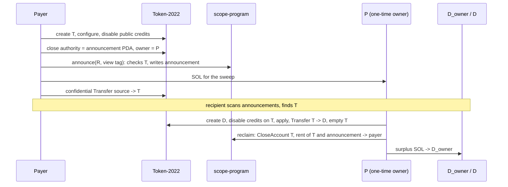

# Protocol

TL;DR: for program reviewers and integrators. After reading you can build both SCOPE transactions by hand, derive every address, and know each check the program makes, with its error code.
The Pinocchio program `scope-program` has four instructions (`announce`, `reclaim`, `register`, `deregister`) and is never in the funds path; everything else is stock System, Token-2022 and ZK ElGamal proof program instructions.

Program id `EwbfwDdaRdxzF6wJFBKQmqcGoh93wNFL7FMo31eK9V2H` (`crates/interface/src/lib.rs`). Symbols (R, P, D_owner, view tag) are derived in [crypto.md](crypto.md); the CLIs that build these transactions are in [payer.md](payer.md) and [recipient.md](recipient.md).

## The picture

| Account | Owner program | Created by | Address | Size |
|---|---|---|---|---|
| Payer's source | Token-2022 | payer, once | any confidential account of the payer | per mint |
| T, one-time token account | Token-2022 | payer | `create_with_seed(payer, seed(R), Token-2022)` | 465 bytes for a mint with no account extensions (V11) |
| Announcement | SCOPE | `announce` | PDA `["ann", T]` | 68 bytes |
| P, one-time owner | System | payer's Transfer | Ed25519 key derived per payment | 0 bytes |
| D_owner | System | recipient | Ed25519 key derived per payment | 0 bytes |
| D, destination | Token-2022 | sweep | `create_with_seed(D_owner, "scope-sweep/v1", Token-2022)` | per mint |
| Registry entry (optional) | SCOPE | `register` | PDA `["meta", wallet, 1u16 LE]` | 109 bytes |

### Transaction 1: the payer pays one stealth row

One v1 transaction (V21), one signature, 2,998 bytes of 4,096, 254,565 CU at bump 255 (V56, V73). Built by `scope_client::ix::stealth_setup` plus the transfer.

| # | Instruction | Signer | Notes |
|---|---|---|---|
| 1 | System CreateAccountWithSeed | payer | base payer, owner Token-2022, space from the mint, rent from the sysvar. If someone pre-funded T's address, the client replaces this with Transfer, AllocateWithSeed, AssignWithSeed (V76) |
| 2 | T22 InitializeAccount3 | | owner = payer |
| 3 | T22 ConfigureAccount | payer | credit cap 1, proof at offset +1 |
| 4 | ZK VerifyPubkeyValidity | | inline |
| 5 | T22 DisableNonConfidentialCredits | payer | |
| 6 | T22 SetAuthority CloseAccount | payer | to the announcement PDA |
| 7 | T22 SetAuthority AccountOwner | payer | to P; clears any delegate (V2) |
| 8 | SCOPE `announce` | payer | R, view tag |
| 9 | System Transfer payer to P | payer | amount from `fees::sweep_funding` ([payer.md](payer.md)) |
| 10 | T22 confidential Transfer source to T | payer | proofs at offsets 1, 2, 3 |
| 11-13 | ZK VerifyCiphertextCommitmentEquality, VerifyBatchedGroupedCiphertext3HandlesValidity, VerifyBatchedRangeProofU128 | | inline |

A plain row is only instructions 10 to 13 into the recipient's existing account: 2,395 bytes, 237,792 CU (V49, V73).

### Transaction 2: the recipient sweeps

One v1 transaction, fee payer P, signed by P and D_owner. Full form with an auditor and public dust: 3,402 bytes, 276,007 CU (V68, V73).

| # | Instruction | Signer | Notes |
|---|---|---|---|
| 1 | System Transfer P to D | P | only D's rent deficit, so a pre-funded D still works |
| 2-3 | System AllocateWithSeed, AssignWithSeed | D_owner | base D_owner, seed `scope-sweep/v1`, owner Token-2022 |
| 4 | T22 InitializeAccount3 | | owner = D_owner |
| 5-6 | T22 ConfigureAccount, ZK VerifyPubkeyValidity | D_owner | |
| 7 | T22 DisableNonConfidentialCredits on D | D_owner | |
| 8 | T22 DisableConfidentialCredits on T | P | T accepts nothing after this transaction |
| 9 | T22 ApplyPendingBalance on T | P | |
| 10-13 | T22 confidential Transfer T to D, three proofs | P | full balance |
| 14-15 | T22 EmptyAccount on T, ZK VerifyZeroCiphertext | P | over the post-transfer ciphertext (V8, V51) |
| 16 | T22 ApplyPendingBalance on D | D_owner | the transfer is D's first credit, so the funds are spendable at once (V87) |
| 17 | T22 Burn | P | only if T holds a public amount (V6) |
| 18 | SCOPE `reclaim` | none | rent of T and the announcement to the payer |
| 19 | System Transfer P to D_owner | P | surplus, only when D_owner can receive it; P keeps its rent reserve (V24, V65) |

Without 16 and 17 this is the transfer-only form the client falls back to; the retry and fallback rules are in [recipient.md](recipient.md).

## How are addresses derived?

| Address | Derivation | Source |
|---|---|---|
| T | `create_with_seed(payer, seed, Token-2022)`, `seed` = lowercase hex of the first 16 bytes of `sha256("stealth-ta/v1" \|\| R)`, 32 ASCII characters | `crates/interface/src/seeds.rs`; seed limit V17 |
| Announcement | `find_program_address(["ann", T], program)`, canonical bump stored at offset 3 | `programs/scope/src/address.rs` |
| Registry entry | `find_program_address(["meta", wallet, scheme_id as u16 LE], program)` | same; sRFC-42 v1 seeds (V81) |
| D | `create_with_seed(D_owner, "scope-sweep/v1", Token-2022)` | `crates/client/src/sweep.rs` |

The System program allocates a seed address only when its base signs (V16), so only the payer can create T and only D_owner can create D. T has no ImmutableOwner, since that blocks the handover (V2); this is why T is not an associated token account, which always gets ImmutableOwner (V10a).

## What do the program's accounts hold?

**Announcement**, 68 bytes (`crates/interface/src/state.rs`, V33):

| Offset | Field | Size |
|---|---|---|
| 0 | discriminator = 1 | 1 |
| 1 | version = 1 | 1 |
| 2 | view tag | 1 |
| 3 | bump | 1 |
| 4 | R | 32 |
| 36 | payer, receives every rent refund | 32 |

P and the mint are not stored: P is T's owner and the mint is in T. There is no per-recipient field to filter on, so a scanner fetches every announcement (`getProgramAccounts`, data size 68, bytes `[1, 1]` at offset 0) and checks tags locally (V64, V67).

**Registry entry**, 109 bytes, sRFC-42 v1's `MetaAddressEntry` byte for byte (slnt a958ece, `programs/registry/src/lib.rs` 117-130; V81):

| Offset | Field | Size |
|---|---|---|
| 0 | Anchor discriminator `sha256("account:MetaAddressEntry")[..8]` | 8 |
| 8 | registrant | 32 |
| 40 | scheme id, u16 LE (= 1) | 2 |
| 42 | bump | 1 |
| 43 | version (= 1) | 1 |
| 44 | B_spend | 32 |
| 76 | B_scan | 32 |
| 108 | flags (= 0) | 1 |

Code that reads slnt entries reads ours; the PDA differs because it derives from our program id. Lookups fetch every entry (data size 109, discriminator at offset 0) and pick locally (V81). The meta-address string that works without the registry is defined in [crypto.md](crypto.md).

## What does each instruction check?

The first data byte selects the instruction: 0 `announce`, 1 `reclaim`, 2 `register`, 3 `deregister`; anything else, or empty data, fails with `InvalidInstruction` (0). Errors are `Custom(code)` from `ScopeError` (`crates/interface/src/error.rs`), codes append-only. Too few accounts fails with the runtime's `NotEnoughAccountKeys`. Checks run in the order listed, and every custom-code check in all four instructions is tripped by its own test asserting its code (V54, V81, V82).

### announce

Accounts: payer (signer, writable), T, announcement (writable), System program. Data: R 32, view tag 1.

| # | Check | Error |
|---|---|---|
| 1 | data after the discriminator is exactly 33 bytes | 1 `InvalidInstructionData` |
| 2 | payer signed | 2 `PayerNotSigner` |
| 3 | fourth account is the System program | 3 `WrongSystemProgram` |
| 4 | T = `create_with_seed(payer, seed(R), Token-2022)`, binding R and the payer to T | 5 `TokenAccountAddressMismatch` |
| 5 | T is owned by Token-2022 and parses as a token account | 6 `NotTokenAccount` |
| 6 | T is initialized | 7 `TokenAccountNotInitialized` |
| 7 | T's close authority is the announcement PDA | 8 `CloseAuthorityMismatch` |
| 8 | T's owner is not the payer (handover happened) | 9 `OwnerNotHandedOver` |
| 9 | T has no delegate | 10 `DelegateSet` |
| 10 | T has ConfidentialTransferAccount | 11 `MissingConfidentialExtension` |
| 11 | `maximum_pending_balance_credit_counter` = 1 | 12 `CreditCapNotOne` |
| 12 | non-confidential credits disabled | 13 `PublicCreditsEnabled` |
| 12b | no CpiGuard lock on T | 25 `CpiGuardEnabled` |
| 13 | announcement is the canonical PDA `["ann", T]` | 14 `AnnouncementAddressMismatch` |
| 14 | announcement has no data and is owned by System | 15 `AnnouncementInUse` |

Then the program transfers any rent deficit from the payer, allocates and assigns the announcement by System CPIs signed by the PDA (so a pre-funded address still works, V33), and writes the 68 bytes. Checks 7 to 12b make the anti-griefing settings a property of every announced account, not a client promise. The program does not check the mint, its approval policy (V72), the amount, or that T's owner is the P the recipient will derive; the scanner checks those (V64).

### reclaim

Accounts: announcement (writable), T (writable), payer (writable), Token-2022 program. No data, no signer: anyone may call it, and the refund can only go to the stored payer.

| # | Check | Error |
|---|---|---|
| 1 | no data after the discriminator | 1 `InvalidInstructionData` |
| 2 | fourth account is Token-2022 | 4 `WrongTokenProgram` |
| 3 | announcement is owned by this program | 16 `NotAnnouncement` |
| 4 | it is 68 bytes with discriminator 1 and version 1 | 16 `NotAnnouncement` |
| 5 | its address = PDA `["ann", T]` with the stored bump | 14 `AnnouncementAddressMismatch` |
| 6 | payer = stored payer | 17 `PayerMismatch` |

Then Token-2022 CloseAccount by CPI, destination the payer, signed by the PDA; Token-2022 refuses while any balance is nonzero (V4). The announcement's lamports go to the payer and it is closed (V34).

Check 5 stops a decoy: an attacker creates an empty token account X, points its close authority at a victim's announcement, and calls `reclaim` with X. Only `announce` writes announcements, and only at `["ann", T]` for the T it checked, so X derives a different address and the call fails. Without it the victim's announcement would close and the payment would drop out of scan (V34, V54).

### register

Accounts: registrant (signer, writable), entry (writable), System program. Data, in sRFC-42's order: scheme id u16 LE, version, B_spend, B_scan, flags (68 bytes).

| # | Check | Error |
|---|---|---|
| 1 | data after the discriminator is exactly 68 bytes | 1 `InvalidInstructionData` |
| 2 | scheme id 1, version 1, flags 0 | 19 `UnsupportedMetaAddress` |
| 3 | registrant signed | 18 `RegistrantNotSigner` |
| 4 | third account is the System program | 3 `WrongSystemProgram` |
| 5 | entry is the canonical PDA `["meta", registrant, scheme]` | 20 `MetaAddressMismatch` |
| 6 | entry has no data and is owned by System | 21 `MetaAddressInUse` |
| 7 | B_spend is the canonical encoding of a prime-order point (S7) | 22 `InvalidSpendKey` |

Then the program creates the entry the same way as an announcement and writes it. B_scan is not checked on chain; the client refuses low-order scan keys on import (V59).

**S7 in one paragraph.** The curve25519 syscalls multiply only by canonical scalars, so the program computes Q = (L-1)·B_spend and accepts only when Q + B_spend is the identity, Q is not, and -Q re-encodes to the input bytes. Any torsion component makes the sum nonzero; the re-encoding refuses non-canonical input (`programs/scope/src/curve.rs`; V82). The algebra is in [crypto.md, Curve checks](crypto.md#curve-checks).

### deregister

Accounts: registrant (signer, writable), entry (writable). Data: scheme id u16 LE.

| # | Check | Error |
|---|---|---|
| 1 | data after the discriminator is exactly 2 bytes | 1 `InvalidInstructionData` |
| 2 | registrant signed | 18 `RegistrantNotSigner` |
| 3 | entry is owned by this program | 23 `NotMetaAddressEntry` |
| 4 | entry is 109 bytes with the entry discriminator | 23 `NotMetaAddressEntry` |
| 5 | stored registrant = signer | 24 `RegistrantMismatch` |
| 6 | stored scheme = data scheme, and address = PDA `["meta", registrant, scheme]` with the stored bump | 20 `MetaAddressMismatch` |

The entry's lamports go to the registrant and it is closed; the wallet can register again (V81).

## Which Token-2022 behaviour does this rely on?

| Behaviour | What it gives SCOPE | V |
|---|---|---|
| ConfigureAccount checks only that the current owner signed | the payer configures T as its temporary owner | V1 |
| SetAuthority(AccountOwner) checks only the current owner and clears the delegate; it refuses a frozen account, ImmutableOwner and an enabled CpiGuard | the handover; default-frozen and non-transferable mints cannot be used | V2, V10 |
| ApplyPendingBalance, Transfer and EmptyAccount authorise against the live owner | after the handover only P can move or empty T | V3 |
| The pending-credit cap is written once at configure and admits exactly that many credits | with cap 1, at most one credit is outstanding | V7 |
| The disabled public-credit flag is checked only in Transfer; MintTo ignores it | a mint authority can still mint public dust; the sweep burns it | V6 |
| CloseAccount authorises the close authority and refuses any nonzero public or confidential balance | `reclaim` works only after the sweep; P cannot close T itself | V4 |
| With CpiGuard on, CloseAccount under CPI fails unless the destination is the owner | P enabling CpiGuard blocks `reclaim` | V5 |
| Transfer sets the source's available balance to the equality proof's ciphertext | the zero-ciphertext proof for EmptyAccount can be built before the transaction lands | V8, V51 |
| A mint auditor key must equal the proof's third handle | the auditor can read every amount | V12 |
| A credit fails on a mint that does not auto-approve; `announce` does not check approval | the client refuses such mints for stealth rows | V72, V76 |
| InitializeAccount3 initialises every extension the mint requires and fails if the account is too small | the client sizes T from the mint | V9, V11 |
| v1 transactions take CU and loaded-accounts limits from the header, default 0 | every transaction sets both | V18, V19, V21 |

Which mints the client accepts, and why, is in [payer.md](payer.md).

## What does it cost?

Rent is `(size + 128) x 5,080` lamports, read from the Rent sysvar at run time (V23). The base fee is 5,000 lamports per signature (V74).

| Account | Bytes | Rent (lamports) | Paid by | Returned |
|---|---|---|---|---|
| Announcement | 68 | 995,680 | payer | to the payer by `reclaim` |
| T, mint with no account extensions | 465 | 3,012,440 | payer | to the payer by `reclaim` |
| P, minimum while nonzero | 0 | 650,240 | payer, via P's funding | stays with P |
| D, mint with no account extensions | 465 | 3,012,440 | P, from the payer's funding | stays with the recipient |
| Registry entry | 109 | 1,203,960 (V23 formula) | registrant | by `deregister` |

So a stealth row locks 4,008,120 lamports of payer rent until the sweep's `reclaim` returns it exactly (V77). P's funding formula is in [payer.md](payer.md).

| Instruction | CU measured (LiteSVM, bump 255) | CI ceiling | V |
|---|---|---|---|
| `announce` | 6,373; each lower bump adds about 1,500 | 7,700 | V55 |
| `reclaim` | 3,256 | 4,000 | V55 |
| `register` | 8,728 | 10,500 | V82 |
| `deregister` | 489 | 600 | V81 |

| Transaction | Signatures | Bytes | CU measured | V |
|---|---|---|---|---|
| Plain payment | 1 | 2,395 | 237,792 | V49, V73 |
| Stealth payment | 1 | 2,998 | 254,565 | V56, V73 |
| Full sweep (auditor, dust burn, reclaim) | 2 | 3,402 | 276,007 | V68, V73 |
| `reclaim` alone (payer's backstop) | 1 | not measured | 3,260 | V73 |

The range proof alone is 200,000 CU and 1,001 bytes (V27); it dominates every payment. Measurements are LiteSVM with a mint auditor; the compute-unit limit the client sets for each shape is in [payer.md](payer.md). Whether a public cluster enforces the same header limits is spike S1 ([plan.md](plan.md)).

## Who can upgrade the program, and what could an upgrade do?

Where the program is deployed, who holds its upgrade authority and whether a verifiable build exists: [plan.md](plan.md).

The program holds no authority over tokens: the announcement PDA is only a close authority, and CloseAccount needs zero balances (V4). A malicious upgrade could refuse or redirect rent refunds, drop announcements so payments fall out of scan, and, because `announce` and `register` receive a writable signer and the System program, transfer SOL from that signer within the same transaction [unverified]. It cannot move T's confidential balance, which needs P's signature (V3).

## What can block a rent refund?

- **P must empty T.** CloseAccount refuses any balance (V4). A recipient who never sweeps keeps the payer's rent locked; nothing on chain can force it.
- **P must not enable CpiGuard.** It blocks the CPI close in `reclaim` (V5). P is the owner after the handover, so the payer cannot prevent this.
- **Public dust.** If a mint authority mints a public amount into T and the sweep falls back to transfer-only, CloseAccount keeps refusing and the rent stays locked (V4, V6).
- **Freeze.** A frozen T blocks the transfer and the close. Freeze is a mint-authority power; see [privacy.md](privacy.md).

P cannot close T itself, since CloseAccount needs the close authority, the announcement PDA (V4); so the refund only ever goes to the payer.
